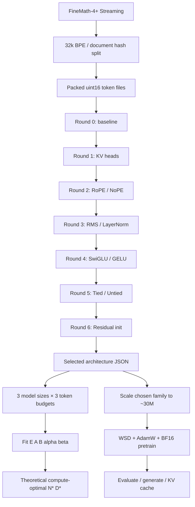

# MathGPT：交给另一个 Agent 的可执行交接手册

> 状态：**源码和本地 CPU 测试已完成；真实 FineMath GPU 训练、六轮消融和 Scaling Law 尚未执行。** 任何报告都必须根据实际日志生成，禁止虚构最优架构或 Loss。
>
> 目标：先进行约六轮**贪心顺序消融**，每轮在当前 baseline 上仅改变一个模块，选胜者更新 baseline；然后固定架构家族，进行 3×3 的 N/D 缩放实验；只**理论计算**预算下的 N*、D*；最后**始终实际训练约 30M 参数模型**。单 GPU 时间上限 48 小时（不是 48 卡并行一小时）。

## 0. 立即执行：Agent 工作协议

1. 阅读 `README.md`、本文件、`docs/experiment_rationale.md`、`docs/cloud_gpu.md`。
2. 在仓库根目录运行 `python -m pytest -q`。若失败先修复，不要运行付费 GPU。
3. 确认 CUDA、BF16、可用显存、磁盘空间、数据许可及 Hugging Face 连通性；将环境信息写到 `runs/environment.json`。
4. 用 `python scripts/prepare.py --tokenizer_docs 30000 --docs 200000` 准备 FineMath-4+，确认 `data/processed/{train,val}.bin` 存在且验证集非空；冻结 tokenizer、manifest 和验证集，后续不改变。
5. 用 `python scripts/greedy_search.py --dry-run` 审阅命令；确认后运行六轮消融；检查 `runs/greedy/decisions.json` 和 `selected_architecture.json`。
6. **务必人工复核**获胜架构：至少三个 seed，重点检查是否只是参数量变化造成 Loss 改善；若证据不足保留更简单的 baseline。当前 Runner 只做单 seed 初筛，不自动完成复核。
7. `python scripts/run_scaling.py --dry-run` 检查 N/D 网格，再运行；使用 `python -m mathgpt.scaling runs/scaling/points.jsonl --flops <明确的FLOPs预算>` 拟合并报告；没有合理的 FLOPs 预算不得写“最优”。
8. `python scripts/scale_to_30m.py` 产生约 30M 配置；`python scripts/train_selected.py --dry-run` 检查后正式训练；记录 Loss、token/s、GPU 小时、Checkpoint、生成样例。
9. 所有真实结果写入 `reports/FINAL_RESULTS.md`，包含设备、种子、训练 token 数、实际参数数、验证 Loss、比较基准、失败实验、预算、误差范围。
10. 没有训练的内容必须标为“未运行”，不能把预期收益写成实测结论。不得将实验数据上传公共仓库而忽略许可。

## 1. 整体结构图



## 2. 六轮消融是一个循环，而不是六组彼此独立的基线

设第 r 轮 baseline 配置为 `b_r`，候选集为仅在第 r 个因素上修改的 `v_{r,j}`。对每个候选使用**同一 tokenizer、训练/验证数据、相同 seed、token 预算、学习率设置**，记录验证交叉熵。若候选相对于当前 baseline 的验证 Loss 下降至少 `min_delta=0.002`，则提升为下一轮 baseline；否则保留旧 baseline。六轮之后产出 `selected_architecture.json`。

- R1：`kv_heads` 1 / 2 / 4（MHA/MQA/GQA，Q heads=4）。
- R2：`position` rope / nope。
- R3：`norm_type` rms / layer。
- R4：`ffn_type` swiglu / gelu。
- R5：`untie` false / true。
- R6：`no_residual_scale` false / true。

**限制**：这是贪心顺序搜索，不是全局最优；因素有交互，顺序影响结果。单 seed 的 Loss 差异可能是噪声。R1/R4/R5 会改变参数量，所以不能把“低 Loss”直接解释为“同参数量架构更好”。在 GPU 预算允许时对赢家做多 seed 重复，并优先补充等参数量对照。初筛 Runner 为可执行框架，不代表研究结论已经确定。

## 3. Scaling Law 与 30M 的关系

选定**架构家族**后，用三档小模型规模和三档 token 预算得到至少 9 条 `(N,D,loss)` 观测。训练模型的真实 N 由代码统计，不以名称替代。拟合

`L(N,D) = E + A*(N/1e6)^(-alpha) + B*(D/1e6)^(-beta)`。

近似 `C≈6ND`，给定**明确的计算 FLOPs 预算 C**，输出理论最优 `(N*,D*)`。这是有限数据拟合，**不保证外推可信**。如残差或参数不确定性大，报告“无法稳定估计”。**不使用拟合得到的 N* 替代最终训练的约 30M 模型。**

## 4. 48 GPU 小时预算（单卡）

| 用途 | 上限小时 |
|---|---:|
| 部署/数据/正确性验证 | 4 |
| 六轮初筛及必要复核 | 6 |
| Scaling Law 代理实验 | 8 |
| 约 30M 正式预训练 | 26 |
| 评估、修复、缓冲 | 4 |
| **合计** | **48** |

预算是**硬上限**，不是性能承诺。GPU 运行前先做 50–100 step 速度试跑，估算每组时长，超预算则降低实验 token 数或减少重复，绝不静默超额运行。当前脚本只在任务之间检查 wall-clock；**单个子进程不会在截止时间自动停止**，执行 Agent 必须配置外层作业超时/云端预算报警。

## 5. 云端可执行命令

```bash
# 在 Linux GPU Pod /workspace/mathgpt30m 目录执行
python -m venv .venv
source .venv/bin/activate
pip install -r requirements.txt
python -m pytest -q
nvidia-smi
python scripts/prepare.py --tokenizer_docs 30000 --docs 200000
python scripts/greedy_search.py --dry-run
python scripts/greedy_search.py --max_hours 6
python scripts/run_scaling.py --dry-run
python scripts/run_scaling.py --max_hours 8
python -m mathgpt.scaling runs/scaling/points.jsonl --flops 1e18
python scripts/scale_to_30m.py
python scripts/train_selected.py --dry-run
python scripts/train_selected.py --steps 5000
```

`--flops 1e18` 是**命令格式示例**，不是对 48 GPU 小时的换算结果；正式报告必须根据实测有效吞吐及训练算力假设解释 C。`--steps 5000` 也是启动示例，需按实际 GPU 吞吐和 26 小时预算调整。

## 6. 验收标准与输出

- `pytest` 通过；至少一次 CPU smoke 和 GPU overfit；GPU Checkpoint 保存/恢复验证。
- `runs/greedy/decisions.json` 含六轮真实记录，每轮 baseline、候选、参数量、验证 Loss、提升与否。
- `runs/greedy/selected_architecture.json` 是架构最终决策文件。
- `runs/scaling/points.jsonl` 包含 9 个真实 N/D/L 点；拟合报告含残差和可靠性说明。
- `configs/final_30m.json` 的 `actual_parameters` 与 30M 目标偏差尽量低（搜索器要求不超过约 2%）。
- `runs/final_30m/last.pt`、`metrics.jsonl`、训练曲线、生成样例。
- `reports/FINAL_RESULTS.md` 应解释每轮选择的原因，注明书中依据和本次实验依据的区别。

## 7. 范围边界

本工程是**预训练 + 架构消融 + Scaling Law + 推理**，**不包含 SFT/DPO/GRPO 后训练**。数学教材未自动抓取，数据默认 FineMath-4+；加入 Stanford 或其他教材前必须核查许可、来源、格式和重复内容。模型规模小，不能承诺获得强数学推理能力。
